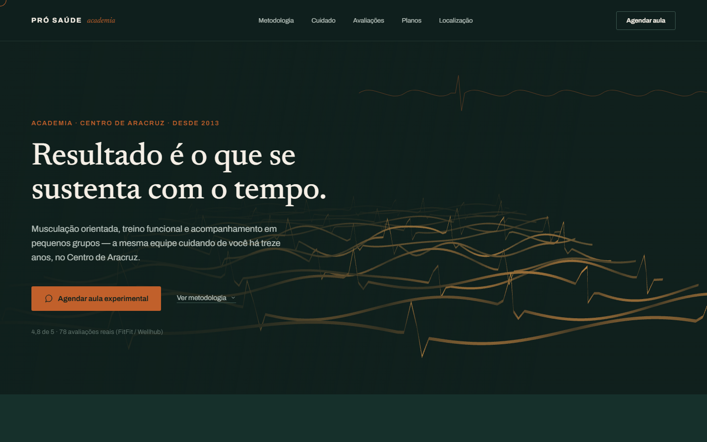

# Pró Saúde Academia

Site conceito para academia de musculação e treino funcional em Aracruz (ES), com fundo 3D interativo em WebGL.

**[▶ Ver o site ao vivo](https://kaynanfrontend.github.io/Pro-Saude-Academia/)**

## Sobre
Conceito autoral inspirado na Pró Saúde Academia, do Centro de Aracruz (ES). Não é o site oficial da empresa. A ideia criativa, "Maré", trata saúde como constância, e um motivo de pulso/batimento se repete em todo o site, inclusive no fundo 3D do hero.

Tipo: Projeto conceito

## Tecnologias
- HTML5
- CSS3
- JavaScript
- GSAP
- ScrollTrigger
- Lenis
- WebGL
- Canvas 2D

## Destaques
- Fundo do hero em WebGL puro, sem Three.js e com matrizes de projeção feitas à mão: uma grade 3D de linhas de batimento que reage ao tempo, ao mouse, à rolagem e ao clique
- Fallback em camadas: Canvas 2D se o WebGL falhar e gradiente em CSS com `prefers-reduced-motion`
- A animação pausa quando o hero sai da tela ou a aba fica em segundo plano (`IntersectionObserver` e `visibilitychange`)
- Coreografia de rolagem com GSAP e ScrollTrigger, rolagem suave com Lenis e fotos em WebP com fallback JPEG

---
Feito por **Kaynan Ribeiro de Sousa** · [musgoestudio.com](https://musgoestudio.com)
